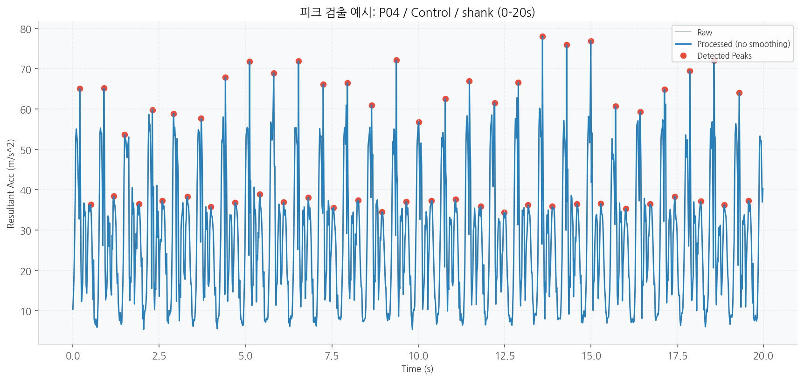
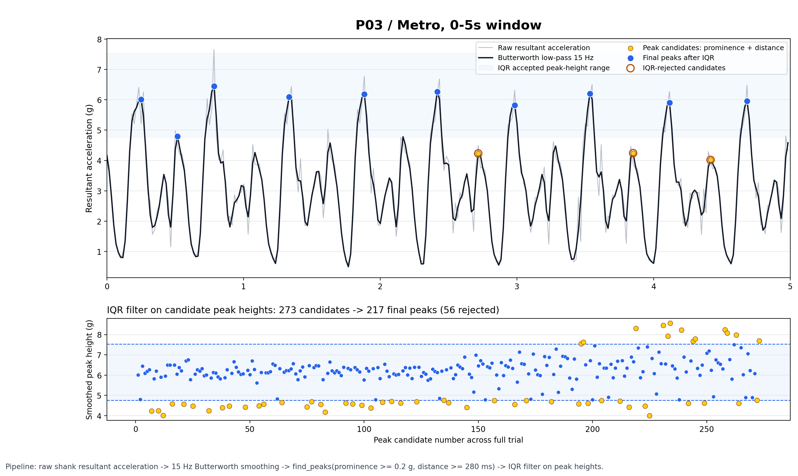
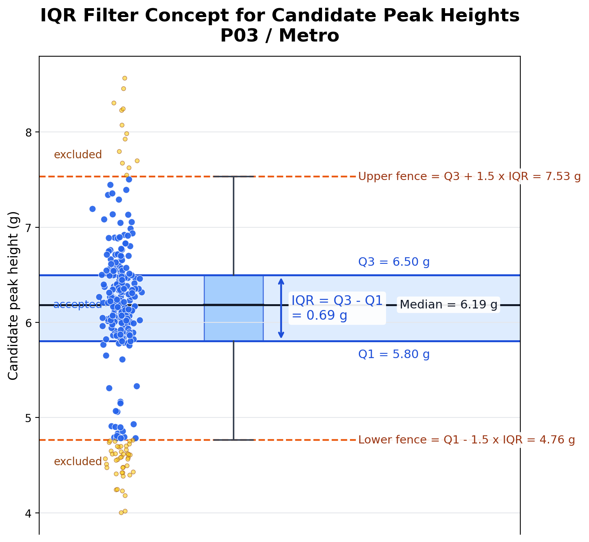
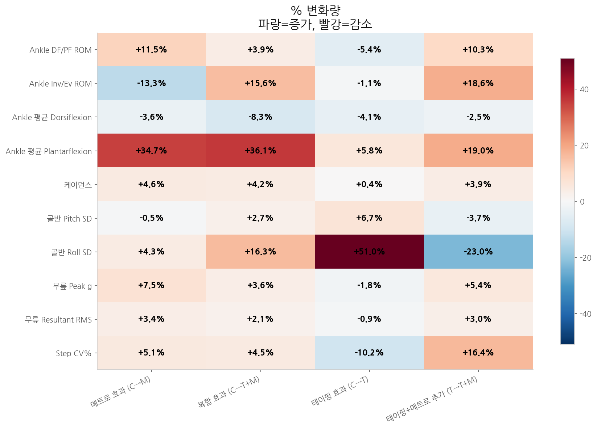
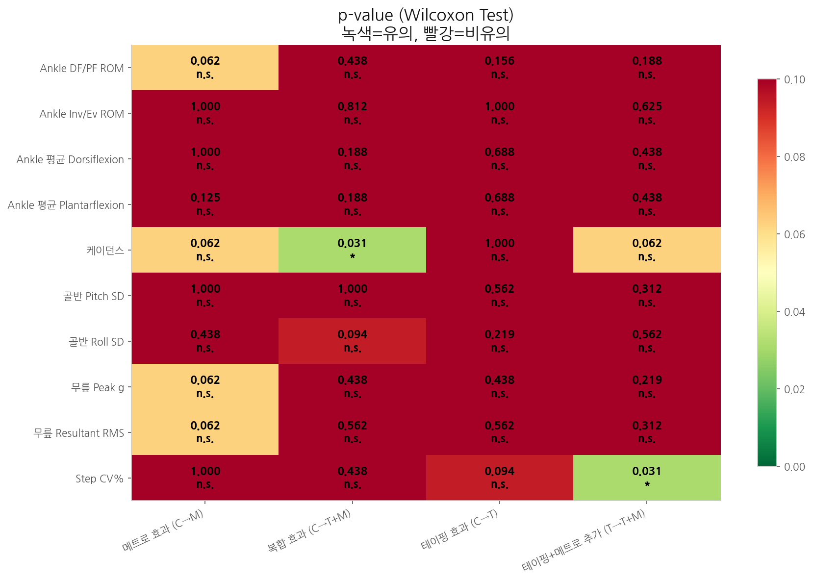
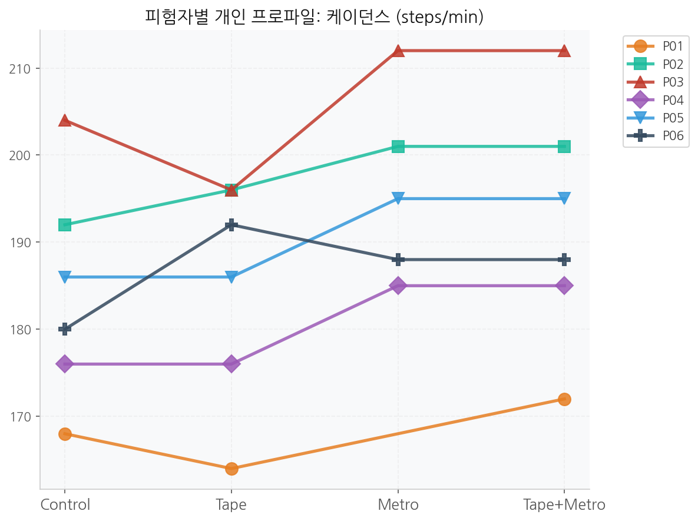
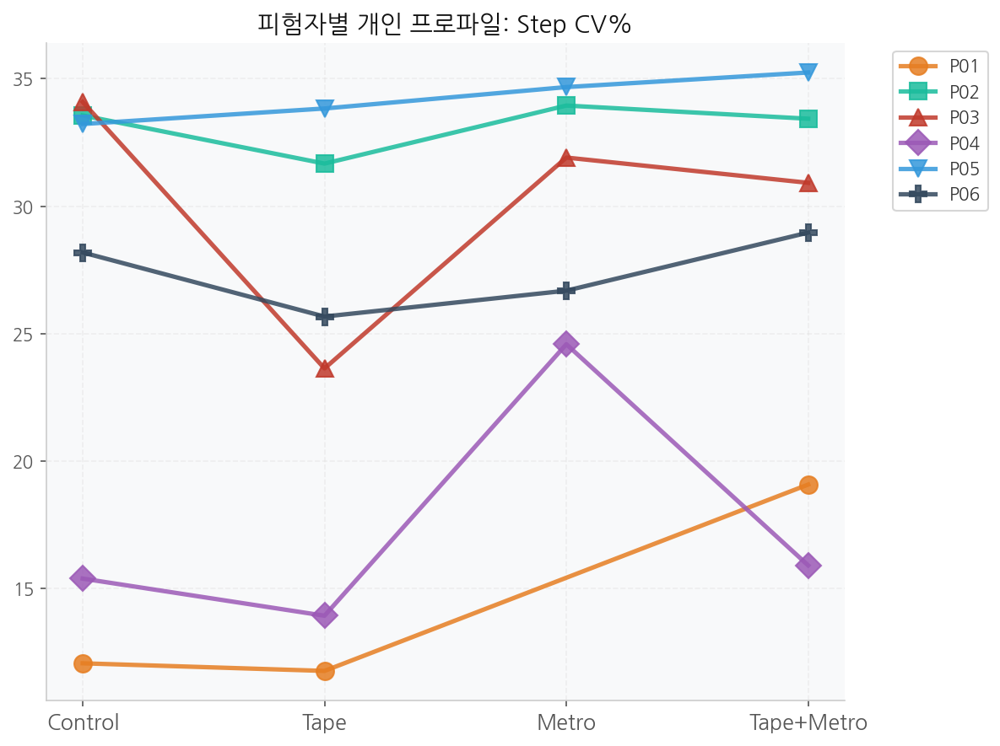
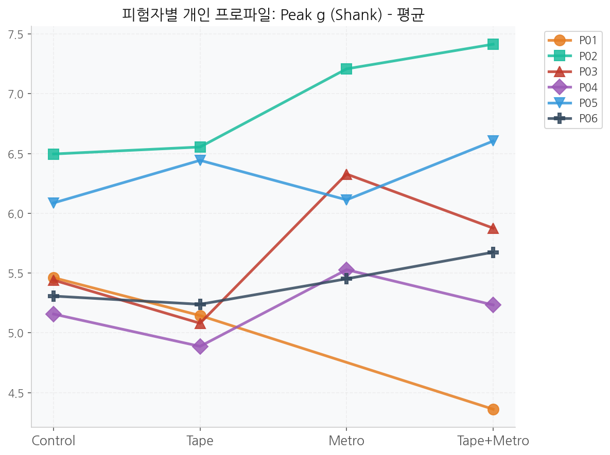

# Tetoronome — 메트로놈·테이핑 러닝 개입 IMU 분석

3개의 IMU(발/정강이/골반)를 신체에 부착하고 러닝 중 **메트로놈(케이던스 유도)** 과 **발목 테이핑** 개입이 충격량, 관절 운동학, 보행 안정성에 미치는 효과를 검증한 N=6 파일럿 연구입니다. 데이터수집 → 원시 IMU CSV → 지표 산출 → 통계 검정 → 시각화까지 전체 분석 파이프라인을 Python으로 직접 구현했습니다.

> 이 저장소는 실제 연구 저장소를 포트폴리오용으로 정리한 사본입니다. 참가자 식별정보는 P01~P06으로 익명화했고, 반복 작업 기록(analysis 하위 날짜 폴더)은 `analysis/archive/`로 모아두었습니다.

## 1. 연구 설계

| 항목 | 내용 |
|---|---|
| 피험자 | 6명 (건강한 성인, 개인별 고정 러닝 속도 13~16km/h 트레드밀) |
| 조건 (Within-subject) | Control / Metro / Tape / Tape+Metro (피험자별 무작위 순서) |
| 센서 | Xsens 계열 IMU 3개 — `foot`(발), `shank`(정강이), `hip`(골반), 공통 샘플링레이트 60Hz |
| 측정 항목 | shank 3축 자유가속도(+resultant), 각 부위 quaternion 기반 자세각 |
| 개입 가설 | 메트로놈: 충격량↓ · 골반 안정성↑ · 보폭 일관성↑ / 테이핑: 충격량↓ · 족저굴곡↑ · 보폭 일관성↑ |

| 그림 | 설명 |
|---|---|
|  | 웜업 3분 → 점진적 강도 증가 → RPE 기준 cadence 측정 → 2분 러닝 블록, 조건 간 충분한 휴식을 두고 4개 조건을 무작위 순서로 진행 |
|  | IMU 3개를 골반(pelvis)·정강이(shank)·발(foot)에 벨트/테이프로 고정 부착 |
|  | 발목 테이핑 개입 조건의 실제 시술 예시 (발목 안정화 패턴) |

## 2. 분석 파이프라인

```
data/{피험자}/{피험자}_{조건}.csv
        │  (60Hz, source_segment ∈ {foot, shank, hip})
        ▼
analysis/pipeline.py      ── 지표 계산 (피험자 × 조건 단위)
        │
        ├─ load_subject_condition()      CSV 로드 + segment 분리
        ├─ _detect_impact_peaks()        충격 피크 검출
        ├─ compute_cadence()             케이던스
        ├─ compute_impact_all_segments() 충격량 지표 (shank)
        ├─ compute_ground_contact_variability()  보폭 일관성 (CV%)
        ├─ compute_pelvis_kinematics()   골반 안정성 (Pitch/Roll SD)
        ├─ compute_ankle_kinematics()    발목 DF/PF, Inv/Ev ROM
        └─ run_statistical_tests()       Wilcoxon + Cohen's d
        ▼
results/metrics_by_condition.csv, statistical_tests.csv, subject_condition_table.csv
        ▼
analysis/visualize.py  ──▶  results/figures/*.png (스파게티 플롯, 히트맵, 조건별 효과 그래프)
        ▼
analysis/run_analysis.py  ── 위 과정을 한 번에 실행하고 콘솔에 핵심 결과 요약 출력
```

### 실행 방법

```bash
cd analysis
pip install numpy pandas scipy matplotlib seaborn
python run_analysis.py
```

### 신호 처리 로직 (핵심 설계 결정)

| 처리 | 방법 | 근거 |
|---|---|---|
| 저역통과 필터 | 4차 Butterworth, cutoff 15Hz | 보행 신호 주성분은 보존하면서 STA(soft tissue artifact)·부착 노이즈 억제 |
| 충격 피크 검출 | `scipy.find_peaks`, 고정 prominence 0.2g, 최소 간격 280ms | 개인별 절대 충격량 차이를 흡수하기 위해 height 대신 prominence 사용, 280ms로 이중 피크(double peak) 방지 |
| 이상치 제거 | Tukey IQR (1.5×IQR) | 피크 높이·관절각 최대치 모두에 적용해 센서 튐값 제거 |
| 케이던스 | foot row 기준 검출 + **수기 기록값으로 최종 대체** | 실험 중 실측한 케이던스를 정답값으로 사용 |
| 통계 검정 | Wilcoxon signed-rank (양측) 강제 적용 + Cohen's d 병기 | N=6 소표본이라 정규성을 가정한 t-test 대신 비모수 검정을 채택, 유의성 하나에 의존하지 않도록 효과크기를 함께 보고 |

| 그림 | 설명 |
|---|---|
|  | 원본 피크 예시 (P04 / Control / shank) |
|  | 0-5초 확대: 회색=원신호, 검정=15Hz 스무딩, 파란 점=최종 피크, 주황 원=IQR로 걸러진 후보 — 스무딩과 280ms 최소 간격이 없으면 착지 후 잔진동이 별도 걸음으로 오검출됨 |
|  | 후보 피크 높이 분포에서 Q1-1.5×IQR ~ Q3+1.5×IQR 범위를 벗어난 값(노란 점)만 이상치로 제외하는 구조 |

## 3. 결과 요약

| 개입 | 가설 | 실측 결과 (Control 대비) | 가설 지지 여부 |
|---|---|---|---|
| 메트로놈 | 충격량 ↓ | Peak g **+7.5%** (n.s.) | ❌ 반대 방향 |
| 메트로놈 | 골반 안정성 ↑ | Roll SD +4.3%, Pitch SD 거의 불변 | ❌ 반대 방향 |
| 메트로놈 | 보폭 일관성 ↑ | Step CV% **+5.1%** (n.s.) | ❌ 반대 방향 |
| 테이핑 | 충격량 ↓ | Peak g −1.8% (n.s.) | ✅ 방향 일치 |
| 테이핑 | 족저굴곡 ↑ | Plantarflexion +5.8% (n.s.) | ✅ 방향 일치 |
| 테이핑 | 보폭 일관성 ↑ | Step CV% −10.2% (n.s.) | ✅ 방향 일치 |

유의미한(p<0.05) 결과는 두 건뿐입니다 — **Control→Tape+Metro 케이던스 증가**, **Tape→Tape+Metro Step CV% 증가** (둘 다 p=.031, N=6 양측 Wilcoxon에서 나올 수 있는 최소 p값).

| 그림 | 설명 |
|---|---|
|  | 4개 비교(C→M, C→T, C→T+M, T→T+M) × 10개 지표 전체 변화율 한눈에 비교 |
|  | 같은 비교의 Wilcoxon p-value — 녹색(0.031) 두 칸을 제외하면 전부 비유의 |
|  | 6명 전원이 Metro 조건에서 케이던스가 오르는 방향으로 일관되게 반응 — 유의성이 나온 이유 |
|  | Tape에서 낮았던 Step CV%가 Tape+Metro에서 다시 오르는 패턴이 대부분 피험자에서 반복 |
|  | 케이던스가 오른 피험자일수록 오히려 충격 피크(g)도 함께 오르는 경향 — 아래 해석의 근거 |

**해석의 핵심은 "메트로놈이 효과가 없었다"가 아니라, IMU 기반 shock proxy가 실제 지면반력과 동일하지 않다는 점입니다.** 케이던스가 오르면서 오히려 shank 가속도가 커진 것은 지면 충격 증가가 아니라 *leg/vertical stiffness 변화에 따른 가속도 반응 증가*로 해석하는 편이 선행 러닝역학 문헌과 더 일치합니다. IMU 가속도는 지면반력의 근사치(proxy)일 뿐 직접 측정값이 아니라는 점이 이 프로젝트에서 얻은 가장 중요한 방법론적 교훈입니다.

## 4. 만났던 문제와 해결 (Engineering & Research Notes)

이 프로젝트에서 실제로 부딪혔던 기술적/방법론적 문제와 대응입니다.

- **이중 피크(double-counting) 문제** — 정강이 가속도 신호에 착지 충격 뒤 잔진동이 남아 `find_peaks`가 한 걸음을 두 걸음으로 셈. → 15Hz Butterworth로 스무딩하고, height 대신 **고정 prominence(0.2g)** + **최소 간격 280ms**를 함께 걸어 해결. (개인마다 절대 충격량이 달라 height 기준은 오탐이 많았음) 위 전처리 그림의 회색(원신호) vs 검정(스무딩) 선에서 잔진동이 사라지는 것을 직접 확인할 수 있습니다.

- **단일 IMU로 양발 케이던스를 못 잡는 문제** — 편측(unilateral) 센서라 자동 검출 케이던스가 실측치와 어긋남. → 실험 중 스톱워치로 직접 잰 케이던스를 확보해 자동 검출값을 대체하는 수동 보정 테이블(`MANUAL_CADENCE`)을 파이프라인에 내장. 자동 검출은 걸음 간격 기반 지표(CV%, 보폭 일관성)에만 사용.

- **피험자 1명의 이상치(outlier) 조건** — 한 피험자의 Tape+Metro 조건에서 발목 각도가 다른 조건·피험자 대비 물리적으로 설명되지 않는 값으로 튐(센서 미세 이탈 가능성). → 해당 셀만 결측 처리하고 그 사실을 코드 주석에 명시(조용히 평균에 섞지 않음).

- **공유 컬럼을 서로 다른 센서처럼 오독할 위험** — CSV의 `shank_free_acceleration_*` 컬럼은 shank IMU 하나에서만 측정되고 foot/hip row에는 가장 가까운 시각의 값이 그대로 복사(broadcast)됨. 이를 모르고 보면 "발·무릎·골반 3곳의 독립적인 충격 측정"처럼 보일 수 있음. → `pipeline.py` 상단에 이 broadcast 구조를 명시하고, "같은 shank 신호를 서로 다른 시점에서 읽은 것"으로 해석 범위를 한정.

- **인코딩 손상** — 작업 기록 파일이 UTF-16 LE와 UTF-8이 섞여 한글이 깨짐. → UTF-8로 재저장하며 원문 복원.

- **소표본(N=6) 통계에서 유의성에 매몰될 위험** — 양측 Wilcoxon 최소 p값이 0.031이라 6명 전원이 같은 방향으로 반응해야만 유의해짐. → p-value 단독 보고를 지양하고 **Cohen's d, 변화율(%), 개인별 스파게티 플롯**을 항상 함께 제시해 "유의하지 않음 = 효과 없음"으로 오독되지 않게 구성.

- **초안 리포트의 인용 과대해석(overclaim)** — 초기 결과 해석 초안에서 일부 인용(Collins 2009, Thaut 1993 등)이 실제로는 뒷받침하지 않는 주장(러닝 시 족저굴곡 증가, push-off 강화 등)에 붙어 있었음. → 원문을 재확인하는 별도 인용 감사 절차를 만들어 과대해석 항목을 전부 식별하고, 검증되지 않은 문장은 제거하거나 더 약한 표현으로 다운시프트. 2차 독립 재검증까지 거쳐 수정 전/후를 대조 기록.
  - 원칙: **원문을 직접 확인하지 못한 인용은 사실로 서술하지 않는다.** 링크만 확보되고 원문 대조가 안 된 자료는 `literature_pack/99_link_only/`에 따로 분리.

- **IMU 측정 자체의 구조적 한계** — soft tissue artifact(연부조직 진동), 자기장 간섭(Roll/Yaw 추정 오차), 자이로 적분 드리프트 등은 지표별로 영향 정도가 다름. → 어떤 지표가 어떤 오차원에 취약한지 구분해, 가설-결과 불일치를 "메트로놈이 실패했다"가 아니라 "측정 한계 vs 실제 개입 효과"로 나눠 해석하도록 함 (3장 해석 참고).

## 5. 폴더 구조

```
tetoronome-portfolio/
├── assets/                    # README에 직접 삽입되는 그림 (익명화된 결과/파이프라인 그림)
├── data/                      # 피험자별 원시 IMU CSV (P01~P06, 60Hz, foot/shank/hip) — 폴더만 유지, 내용은 git에서 제외
├── analysis/
│   ├── pipeline.py            # 지표 계산 (피크 검출, 충격량, 케이던스, 관절/골반 kinematics, 통계)
│   ├── run_analysis.py        # 전체 파이프라인 실행 진입점
│   ├── visualize.py           # results/figures/ 생성
│   └── add_table.py, plot_change_rates.py
├── literature_pack/            # 결과 해석을 뒷받침/반박하는 문헌 감사 자료 (인용 검증 기록 포함)
├── results/                    # metrics_by_condition.csv 등 + figures/ — 폴더만 유지, 내용은 git에서 제외 (run_analysis.py로 재생성)
├── 보고용 figure/               # 실험설계·부착·테이핑 사진 및 최종 보고서 PDF
└── Research_object.md, Agent_handoff/01_analysis.md   # 가설 정의 및 작업 이력
```

## 6. 재현 시 참고

- `data/`, `results/`는 git에 폴더만 있고 내용은 제외되어 있습니다. `data/`를 원본 CSV로 채운 뒤 `python analysis/run_analysis.py`를 실행하면 `results/`가 그대로 재생성됩니다.
- `data/`는 원시 CSV 특성상 용량이 큽니다(총 ~430MB). GitHub에 원본까지 올릴 계획이면 Git LFS 사용을 권장합니다.
